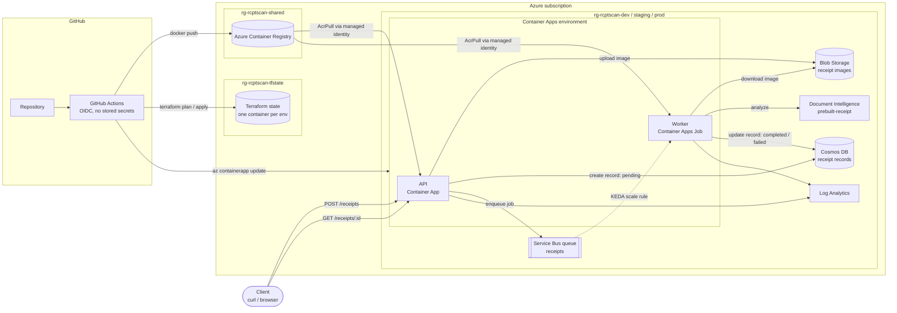
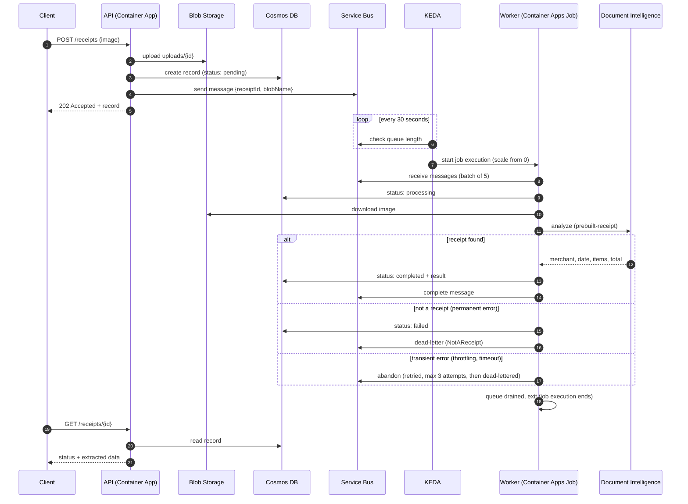
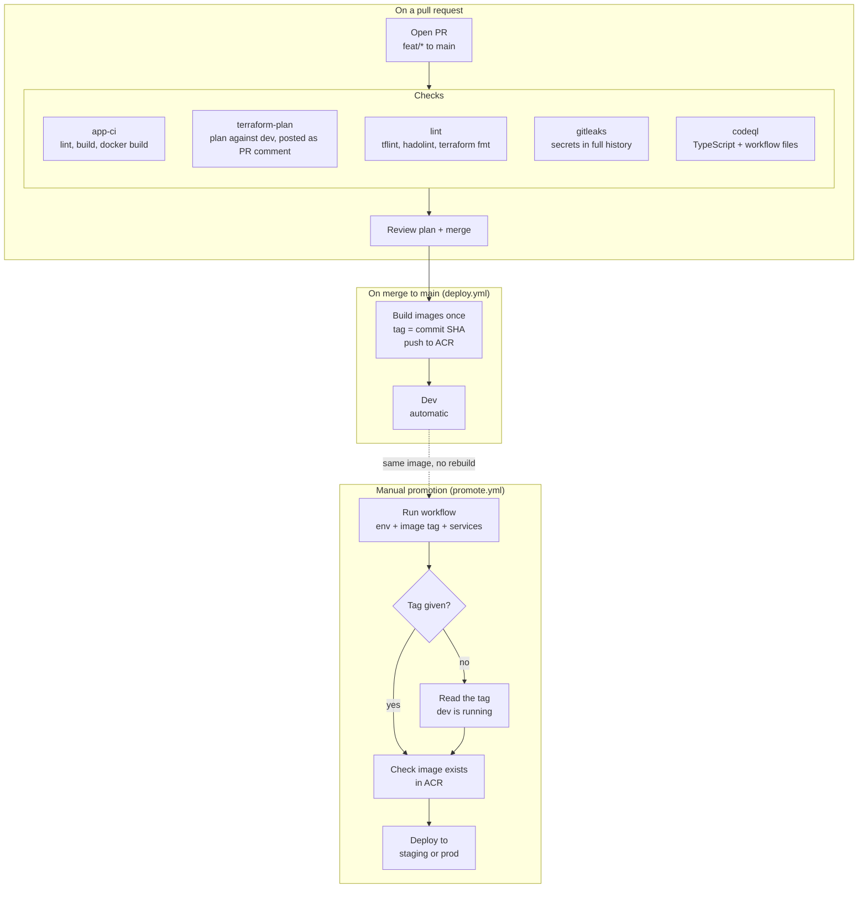

# Architecture

This document explains how the receipt scanner is put together and why it was built this way. For setup steps, see the [README](./README.md).

---

## 1. System overview

Each environment (dev, staging, prod) gets its own resource group with its own copy of everything in the `rg-rcptscan-<env>` box. Only the container registry and the Terraform state storage are shared.

| Environment | Region    |
| ----------- | --------- |
| dev         | East US   |
| staging     | East US 2 |
| prod        | East US   |
| shared (ACR, Terraform state) | East US |

Each environment's region is set by `location` in its `.tfvars` (default `eastus`). Staging runs in East US 2 because creating its Container Apps environment in East US failed twice on Azure capacity. Pulling images from the shared registry in East US works across regions.

---

## 2. Request flow

Things to note:

- **The API never waits on the AI call.** It returns `202 Accepted` straight away, and the client checks back for the result. Slow or failed extraction can't make uploads slow or fail.
- **The worker runs as a Job, not an always-on app.** KEDA starts an execution only when there are messages. The execution drains the queue and exits, so you pay nothing while the queue is empty.
- **Retries depend on the kind of error.** Throttling or timeouts get up to 3 attempts. "This isn't a receipt" is dead-lettered immediately, because retrying can't fix it and every attempt is a paid Document Intelligence call.

---

## 3. Identity and access

There are no connection strings, keys, or passwords in the deployed apps. Everything authenticates with **user-assigned managed identities** and Azure RBAC.

| Identity          | Resource              | Role                                   | Why                                  |
| ----------------- | --------------------- | -------------------------------------- | ------------------------------------ |
| `id-<env>-api`    | Storage account       | Storage Blob Data Contributor          | Upload receipt images                |
| `id-<env>-api`    | `receipts` queue      | Azure Service Bus Data Sender          | Enqueue jobs                         |
| `id-<env>-api`    | Cosmos DB             | Built-in Data Contributor (data plane) | Create and read records              |
| `id-<env>-api`    | Shared ACR            | AcrPull                                | Pull its image                       |
| `id-<env>-worker` | Storage account       | Storage Blob Data **Reader**           | Read images (cannot write or delete) |
| `id-<env>-worker` | `receipts` queue      | Azure Service Bus Data Receiver        | Consume jobs                         |
| `id-<env>-worker` | Document Intelligence | Cognitive Services User                | Call the receipt model               |
| `id-<env>-worker` | Cosmos DB             | Built-in Data Contributor (data plane) | Update records                       |
| `id-<env>-worker` | Shared ACR            | AcrPull                                | Pull its image                       |

Key-based auth is **turned off** on Storage, Cosmos DB, and Document Intelligence. The one exception is the KEDA scale rule, explained in the design decisions below.

### Pipeline identities

Each environment has its own Entra app registration that GitHub Actions signs in as through **OIDC federated credentials**. GitHub never stores a client secret.

| Identity              | Can sign in from                     | Permissions                                                                                                |
| --------------------- | ------------------------------------ | ---------------------------------------------------------------------------------------------------------- |
| `gh-rcptscan-dev`     | `environment:dev` and `pull_request` | Contributor + RBAC Admin on `rg-rcptscan-dev`, its own state container, **AcrPush** on the shared registry |
| `gh-rcptscan-staging` | `environment:staging`                | Contributor + RBAC Admin on `rg-rcptscan-staging`, its own state container                                 |
| `gh-rcptscan-prod`    | `environment:prod`                   | Contributor + RBAC Admin on `rg-rcptscan-prod`, its own state container                                    |

Every environment identity can also grant **only the AcrPull role** on the shared registry. This uses an Azure RBAC condition (ABAC), so a compromised pipeline can't hand itself or anyone else wider access to the registry.

---

## 4. CI/CD flow

### Three workflows, one set of deploy steps

| Workflow          | Trigger                            | What it does                                                         |
| ----------------- | ---------------------------------- | -------------------------------------------------------------------- |
| `deploy.yml`      | Push to `main`, or manual          | Builds both images once, pushes them to ACR, deploys to **dev only** |
| `promote.yml`     | Manual (**Run workflow**)          | Deploys an image that's already in ACR to one environment            |
| `_deploy-env.yml` | Called by the two above (reusable) | The actual deploy steps, shared so dev and promotions can't diverge  |

Every deploy, whether from `deploy.yml` or `promote.yml`, runs the same steps in `_deploy-env.yml`:

1. Sign in to Azure as **that environment's** identity (OIDC).
2. Check the requested image tag exists in ACR, so a typo fails before anything changes.
3. `terraform plan`, with the plan written to the job summary, then `terraform apply`.
4. `az containerapp update` (API) and/or `az containerapp job update` (worker) to the image tag.
5. Smoke test `/healthz`, with retries to cover cold starts.

Each environment takes its own concurrency lock (`deploy-<env>`), so two deploys never run Terraform against the same state at once, while different environments can deploy in parallel.

### Promoting an image

`promote.yml` takes three inputs:

| Input         | Options                 | Notes                                                        |
| ------------- | ----------------------- | ------------------------------------------------------------ |
| `environment` | staging, prod, dev      | dev is there for rollbacks                                   |
| `image_tag`   | 12-character commit SHA | **Leave blank** to promote whatever dev is currently running |
| `services`    | all, api, worker        | Deploy one service on its own, e.g. a worker-only fix        |

When `image_tag` is blank, a short job signs in as the **dev** identity (the target environment's identity can't see dev's resource group), reads the image tags on dev's API and worker, and passes that tag on. With `services: all`, it refuses to continue if dev's API and worker are on different tags, rather than guessing.

With a required reviewer on the `prod` GitHub environment (set up in the README), a prod promote also waits for approval after the workflow is started, so picking the wrong option can't deploy to prod by accident.

**Rollback** is the same workflow: promote an earlier tag to the environment. Images are never deleted from ACR by the pipeline, so any previously built SHA can be redeployed.

---

## 5. Design decisions

### Terraform instead of Bicep (and no Deployment Stacks)

I chose Terraform to show multi-environment IaC with remote state, plan-on-PR, and drift detection, alongside the Bicep/AVM work in my client projects. Azure Deployment Stacks were considered, but they only accept Bicep/ARM templates. Terraform's state file already covers what stacks add (tracking managed resources and deleting what's removed from code), apart from deny settings.

### One flat root module, three environments

`infra/app` is a single root module. Each environment runs the same code with its own `.tfvars` and backend config, which guarantees dev, staging, and prod can't drift apart structurally. Splitting storage, Cosmos, and the rest into modules would mean each module is used exactly once, which adds variable and output boilerplate without any reuse. I'd extract a module once a second consumer appears.

### Separate state, identity, and resource group per environment

Each environment has its own state container, pipeline identity, and resource group. The dev pipeline cannot read, change, or lock prod's state or resources, even by mistake.

### Build once, promote the same image

Images are built a single time, tagged with the commit SHA, and the _same_ image is deployed to dev, then promoted to staging, then prod. Promotion never rebuilds: it only points an environment at a tag that already exists in ACR. What was tested in staging is byte-for-byte what reaches prod, and rolling back means promoting an earlier SHA.

Merging to `main` deploys only to dev. Staging and prod are promoted by hand (`promote.yml`), so a merge can never reach them on its own. An earlier version chained dev → staging → prod in one run, but re-running a failed staging deploy then re-ran dev too, and every merge queued a staging deploy whether it was wanted or not.

### Terraform owns the infrastructure, the pipeline owns the image

Terraform creates the Container App and Job with a starting image tag, then ignores image changes (`lifecycle { ignore_changes = [...image] }`). Deploys change the image with `az containerapp update`. This keeps infrastructure plans clean: an infra PR never shows a diff that would roll back an app version CI deployed.

### Container Apps Job for the worker, not an always-on Container App

The worker is event-driven and bursty. A Job scaled by KEDA from 0 to N costs nothing while idle, and each execution drains the queue then exits. The trade-off is latency: KEDA polls every 30 seconds and a cold container has to start, so a receipt takes about 30–60 seconds end to end. If faster results mattered, the alternative is an always-on Container App with a minimum of 1 replica, at an always-on cost.

### Async API (202 Accepted + polling)

The upload request does no AI work. It stores the image, records the job, and queues it. This keeps uploads fast and reliable no matter how slow or flaky the extraction is, and it lets the worker scale independently of the API.

### Managed identity everywhere, with one documented exception

All app-to-service traffic uses managed identity. The exception is the **KEDA Service Bus scale rule**, which needs the Manage permission to read the queue length. It uses a shared access policy scoped to the `receipts` queue only, and its value lives only in Terraform state (Entra-only storage). The worker itself still receives messages with its managed identity. The next improvement would be moving the scaler to managed-identity auth.

### Region per environment

The region is a per-environment variable, not hard-coded, so one environment can move without touching the others. Moving one replaces every resource in it, so it's only done for an empty or rebuildable environment. When staging moved from East US to East US 2, two services held on to their names after deletion and had to be cleaned up by hand: Log Analytics (soft-deleted for 14 days, removed with `--force`) and Document Intelligence (soft-deleted for 48 hours, purged by an Owner, because the pipeline identity is scoped to its resource group and can't purge). Cosmos DB and Service Bus only needed a retry once Azure finished deleting them.

### Free tiers in dev, pay-per-use in staging and prod

Cosmos DB's free tier and Document Intelligence's F0 tier are each limited to one per subscription, so only dev uses them. Staging and prod use Cosmos DB serverless and Document Intelligence S0: no fixed monthly cost, billed per request or page.

### Permanent vs transient errors in the worker

Errors that retrying can't fix, such as "no receipt detected", are thrown as `PermanentError` and dead-lettered immediately. Everything else is retried up to 3 times. This avoids paying for 3 identical Document Intelligence calls on an image that will never be a receipt.

### Rate limiting on uploads

Every upload in staging and prod becomes a paid Document Intelligence call, so `POST /receipts` is limited per client IP. The counter lives in each replica's memory, so the effective limit scales with the replica count. At scale, this would move to a shared store (Redis) or to the edge (Azure Front Door / API Management).

### Supply-chain hardening

Third-party GitHub Actions are pinned to full commit SHAs instead of version tags, because tags can be moved to malicious code (as in the 2025 `tj-actions/changed-files` incident). Dependabot keeps the SHAs up to date. Gitleaks scans the full git history, and CodeQL scans both the TypeScript and the workflow files.

---

## 6. Known limitations and next steps

- **Monitoring and alerting:** alerts on DLQ growth, API 5xx errors, and failed job executions, each linked to a runbook section.
- **Runbook and ops workflows:** manual workflows for rollback, DLQ resubmission, and breaking a stuck state lock.
- **KEDA scaler auth:** move from a queue-scoped key to managed identity (likely through the `azapi` provider).
- **Prod plan before approval:** a separate read-only "plan" identity so the real prod plan can be reviewed _before_ approving the deploy.
- **Private networking:** VNet-integrated Container Apps environment plus private endpoints for Storage, Cosmos, Service Bus, and Document Intelligence.
- **Low-confidence results:** flag results below a confidence threshold as `needsReview` instead of trusting them.
- **Frontend:** a small upload page, ideally behind authentication.
